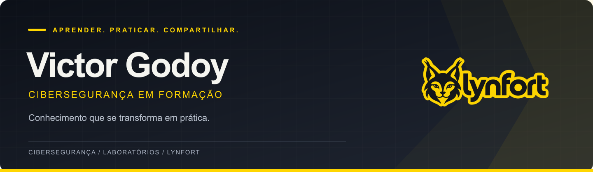
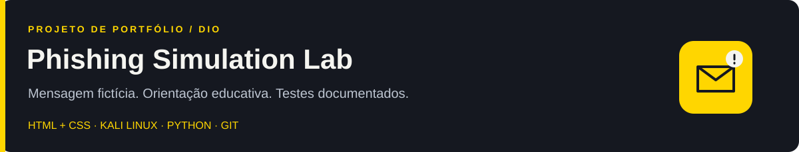
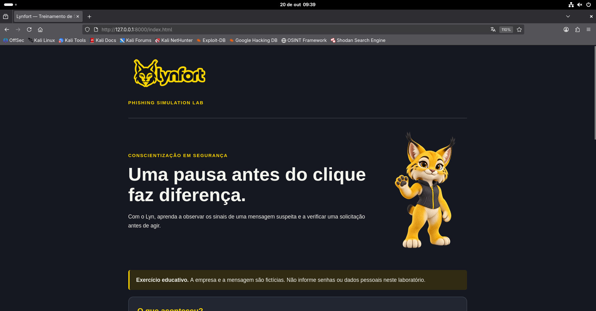

  

<h1 align="center">Olá, eu sou o Victor Godoy.</h1>

  

  <a href="#sobre-mim">Sobre mim</a> ·
  <a href="#projeto-em-destaque">Projeto em destaque</a> ·
  <a href="#tecnologias-em-estudo">Tecnologias</a> ·
  <a href="#vamos-conversar">Contato</a>

---

<h2 id="sobre-mim">Sobre mim</h2>

Sou **Victor Godoy**, estudante de **Sistemas de Informação**, em formação na área de **cibersegurança**. Estou construindo minha trajetória em tecnologia com estudo, experimentação e documentação do que aprendo.

Minha experiência com **varejo e gestão** me aproxima dos desafios de quem precisa cuidar de um negócio. Essa perspectiva também orienta meu interesse por segurança: compreender os riscos e explicar soluções de forma clara e útil.

- **Formação:** graduação em andamento e estudos pela DIO.
- **Prática atual:** laboratórios no Kali Linux, páginas educativas e versionamento com Git.
- **Interesses:** conscientização sobre phishing, fundamentos de segurança e proteção de pequenos negócios.
- **Lynfort:** iniciativa em construção, na qual organizo minha identidade e meus projetos de portfólio em cibersegurança.

<blockquote>
  Meu objetivo é transformar cada etapa do aprendizado em algo que eu consiga explicar, testar e compartilhar.
</blockquote>

<h2 id="projeto-em-destaque">Projeto em destaque</h2>

  

### Lynfort — Phishing Simulation Lab

Laboratório educacional desenvolvido como entrega de um desafio da **DIO**. Uma mensagem corporativa fictícia leva a uma página de conscientização com análise dos sinais suspeitos e orientações de verificação.

**O que implementei:**

- Fluxo de navegação entre a mensagem simulada e o conteúdo educativo.
- Identidade visual da Lynfort, com o mascote Lyn.
- Páginas em HTML e CSS, servidas localmente com Python.
- Testes manuais, capturas de tela e documentação versionada.

**Escopo:** ambiente controlado, sem envio de e-mails, coleta de senhas ou rastreamento de participantes. O laboratório demonstra o funcionamento da interface; não mede a eficácia de uma campanha.

**[Explorar o projeto e as evidências →](https://github.com/BR-Godooy/Lynfort-phishing-simulation-lab)**

<strong>Ver a página educativa</strong>

 

<h2 id="tecnologias-em-estudo">Tecnologias em estudo</h2>

Ferramentas que utilizo nos estudos e na implementação do laboratório.

  

| Área | Aplicação no projeto |
|---|---|
| Linux e virtualização | Ambiente Kali Linux em máquina virtual no VirtualBox |
| HTML e CSS | Construção das páginas de mensagem e conscientização |
| Python | Uso do servidor HTTP local para abrir o laboratório |
| Git e GitHub | Histórico de alterações, documentação e publicação |
| Documentação técnica | Roteiro de cenário, testes e evidências |

<h2 id="aprendizado">O que estou desenvolvendo</h2>

- Fundamentos de segurança e reconhecimento de mensagens suspeitas.
- Familiaridade com Linux e organização de ambientes de laboratório.
- Comunicação técnica com evidências e limites explícitos dos testes.
- Evolução dos projetos por etapas, com registro das decisões.

Os próximos passos da Lynfort incluem ampliar os exercícios educativos e explorar indicadores com dados sintéticos, documentando cada implementação e seus testes.

<h2 id="vamos-conversar">Vamos conversar?</h2>

Tenho interesse em trocar experiências, receber feedback sobre os projetos e conhecer oportunidades de aprendizado e início de carreira em tecnologia e cibersegurança.

**[LinkedIn](https://www.linkedin.com/in/victor-godoy-branco/)** · **[Enviar um e-mail](mailto:victorgodoy.contato@gmail.com)** · **[GitHub](https://github.com/BR-Godooy)**

Contato profissional: **victorgodoy.contato@gmail.com**.

---

  <strong>Victor Godoy</strong> 
  Formação em andamento. Projetos reais. Aprendizado contínuo.

